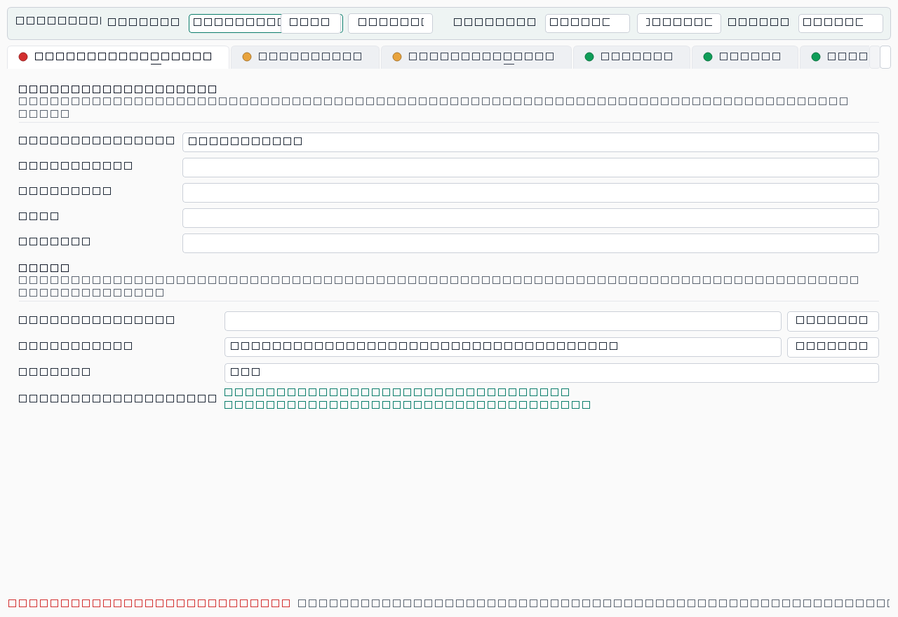

# fishsuite

[](https://github.com/SpaceSorcerer/fishsuite/actions/workflows/test.yml)

**A self-contained Python pipeline for RNA-FISH and immunofluorescence (IF) image quantification and colocalization. It runs without Fiji or ImageJ.**

`fishsuite` segments nuclei (Cellpose, StarDist or Otsu), detects RNA-FISH spots (BigFISH LoG or plain LoG), measures per-nucleus spot counts, intensities and nuclear-versus-cytoplasmic distribution, and quantifies colocalization between two channels. Colocalization includes a rotation "proper-background" null for spots against a diffuse protein. It runs from one `fishsuite` command or a PySide6 desktop GUI, and writes Excel workbooks plus publication-ready figures.

- **Version:** 1.0.0
- **License:** MIT
- **Scope:** validated on human hESC and cardiomyocyte RNA-FISH and IF data. Nothing in the code is species-specific. Defaults that depend on pixel size (nuclear area limits, spot radius, ring and disk sizes) must be retuned for your objective and camera.
- **Status:** `rna_only`, `rna_rna`, `rna_protein` and `if_intensity` are production modes. `ab_ab`, `protein_only` and `pub_images` are not yet implemented (see [Analysis modes](#analysis-modes)).
- **Self-contained:** segmentation and spot-detection code is vendored at `src/fishsuite/core/_vendor/`, checksum-pinned in `_vendor/PROVENANCE.md` and checked by `tests/test_vendor_parity.py`.

---

## Table of contents

1. [Installation](#installation)
2. [Quickstart](#quickstart)
3. [Organising your images](#organising-your-images)
4. [Pixel size and channels](#pixel-size-and-channels)
5. [Analysis modes](#analysis-modes)
6. [The pipeline in depth](#the-pipeline-in-depth)
7. [Colocalization](#colocalization)
8. [Condition groups and the report](#condition-groups-and-the-report)
9. [Command reference](#command-reference)
10. [The desktop GUI](#the-desktop-gui)
11. [Configuration and presets](#configuration-and-presets)
12. [Outputs](#outputs)
13. [Statistics conventions](#statistics-conventions)
14. [Reproducibility](#reproducibility)
15. [Testing](#testing)
16. [Repository layout](#repository-layout)
17. [Citations and methods grounding](#citations-and-methods-grounding)
18. [Scope and limitations](#scope-and-limitations)
19. [Changelog and contributing](#changelog-and-contributing)

---

## Installation

Use a fresh virtual environment. Python must be in the range declared by `requires-python` in `pyproject.toml`.

```bash
# venv
python -m venv fishsuite-env
source fishsuite-env/bin/activate        # Windows: fishsuite-env\Scripts\activate

# or conda
conda create -n fishsuite python=3.12
conda activate fishsuite
```

Then install from PyPI, or from a clone in editable mode:

```bash
pip install fishsuite                    # base install
pip install "fishsuite[all]"             # base + bioformats + gui

git clone https://github.com/SpaceSorcerer/fishsuite
cd fishsuite
pip install -e ".[all]"
```

This installs the `fishsuite` command. Dependency pins live in `pyproject.toml`; read them there rather than from this page.

Cellpose and torch come with the base install. The StarDist backend also needs TensorFlow, which you install separately (`pip install tensorflow`). If you do not want TensorFlow, set `nuclei.backend: cellpose` or `otsu` in your config.

### Extras

| Extra | Adds | Use it for |
|---|---|---|
| `bioformats` | `bioio-bioformats` | `.vsi`, `.czi`, `.lif`, `.nd2`. Needs a JDK; the Bio-Formats jars download on first use. |
| `gui` | `PySide6` | `fishsuite gui` |
| `deck` | `python-pptx` | PowerPoint export from `fishsuite report --deck` |
| `directml` | `torch-directml` | AMD GPU Cellpose on Windows |
| `all` | `bioformats` + `gui` | a normal workstation |
| `dev` | pytest, hypothesis, ruff, build, twine | development |

A base install reads TIFF and OME-TIFF. Install the `bioformats` extra for proprietary formats.

> **Do not install extra bioio reader plugins** such as `bioio-tifffile`, and do not run `pip install bioio-bioformats` on its own. A third-party plugin can read the channel axis of a multi-plane TIFF as Z or T, so DAPI segmentation runs on the wrong plane and finds zero nuclei without an error. A separate install can also upgrade numpy past the pin. Always install the reader through the `bioformats` extra.

### GPU acceleration

The GPU is used only for Cellpose nucleus segmentation during `fishsuite run`. All post-run utilities run on the CPU. Set `nuclei.cellpose_device`:

| Value | Hardware | Install |
|---|---|---|
| `cpu` (default) | any | nothing extra |
| `cuda` | NVIDIA | a CUDA build of torch from pytorch.org |
| `directml` | AMD, Windows | `pip install "fishsuite[directml]"` |

If the requested device is unavailable, the run falls back to CPU with a warning. DirectML targets one GPU, so run one DirectML job at a time.

---

## Quickstart

The short version is in [docs/QUICKSTART.md](docs/QUICKSTART.md).

```bash
# 1. Copy the closest portable preset and edit it for your data
fishsuite presets list
fishsuite presets show generic_100x_0p065 > my_experiment.yaml

# 2. Dry-run: list the images and conditions found, process nothing
fishsuite run -c my_experiment.yaml -i ./raw/my_experiment -o ./results/my_experiment_run1 --dry-run

# 3. Run
fishsuite run -c my_experiment.yaml -i ./raw/my_experiment -o ./results/my_experiment_run1

# 4. Compare conditions (needs conditions.groups, see below)
fishsuite report --run ./results/my_experiment_run1
```

Use a new output folder for every run. Never write into the raw-image folder.

---

## Organising your images

`fishsuite run -i <folder>` discovers images with these extensions only: `.vsi`, `.czi`, `.lif`, `.nd2`, `.tif`, `.tiff`. Files and folders whose names start with `_` are skipped.

**One subfolder per well (recommended).** Each subfolder is one well, which `fishsuite` calls a condition. Its name is the condition label unless you map it:

```
raw/my_experiment/
  WT_1/        img01.tif  img02.tif ...
  WT_2/
  KO_1/
  KO_2/
  Sec-Only/
```

```yaml
conditions:
  mode: subfolders
  subfolder_conditions: {WT_1: WT_1, WT_2: WT_2, KO_1: KO_1, KO_2: KO_2}
  sec_only_folders: ["Sec-Only"]
```

- `subfolder_conditions` maps a folder name to a condition label. An unmapped folder uses its own name and logs a warning. Set `strict_subfolders: true` to make an unmapped folder an error.
- `sec_only_folders` lists secondary-only control folders. `sec_only_files` does the same for filename substrings. These images are labelled `Sec-Only` and never enter a biological group.
- `exclude_subfolders` lists folders to skip.
- When subfolders exist, image files sitting directly in the input folder are ignored, with a warning that names them.
- Discovery looks one level deep. Set `recursive_discovery: true` to walk nested folders; nested folder keys use forward slashes, for example `plate1/WT_1`.

**One flat folder, condition in the filename.** Use `filename_conditions`, an ordered list of `[substring, label]` pairs. The first pair whose substring appears in the filename (case-insensitive) sets the condition. Set `strict_filenames: true` to reject files that match no pair.

```yaml
conditions:
  filename_conditions:
    - ["_ctrl_", "Control"]
    - ["_treated_", "Treated"]
```

**Condition is the line, well is in the filename.** If your folders name the condition but each filename carries the well, set `well_from_image` to a regex with exactly one capture group, for example `'_((?:WT|KO)-\d+)_'` for `sample_WT-1_00.tif`. Every biological image must match, or the run stops.

`--dry-run` prints every discovered image with its condition and secondary-only flag. Check it before every real run. The run also writes the full roster to `resolved_experiment_hierarchy.csv`. For the GUI workflow and the condition, well and field hierarchy, see [docs/CONDITIONS.md](docs/CONDITIONS.md).

---

## Pixel size and channels

### Pixel size

The lateral pixel size is read from image metadata. Set `foci.bigfish_voxel_size_nm` (and `foci.bigfish_voxel_z_nm` for z) to a positive value in nanometres to override it; `0` means read from metadata. In `if_intensity` mode the key is `if_intensity.pixel_size_um` (`0` = metadata).

When neither the config nor the image gives a pixel size:

- The figure and post-run tools (walkthrough, backfill, figure panels) fall back to **0.13 um/px** and log a warning. `fishsuite fig-panels --px-um` overrides it.
- The per-image analysis modes substitute 65 nm/px and log a warning.
- The radial profile refuses to run rather than report distances in the wrong units.

Areas, distances, scale bars and the BigFISH spot kernel all depend on pixel size. If your images carry no calibration, set `foci.bigfish_voxel_size_nm`.

### Channels

Channel indices are set in the `channels` block: `dapi`, `rna`, `rna2`, `antibody`, `antibody2`. They are 0-indexed unless `one_indexed: true`. `-1` means auto-detect.

Auto-detection reads the channel names in the image metadata:

- DAPI: a name containing `dapi`, `hoechst`, `draq5` or `405`.
- RNA: a name containing `488`, `fitc`, `gfp`, `555`, `tritc`, `cy3` or `561`.
- If no name matches DAPI, the brightest unassigned channel is taken as DAPI. Any remaining channel fills RNA in order.

Set the indices explicitly when:

- the mode is `rna_rna` or `rna_protein` (`rna2` and `antibody` have no auto-detection and must be set);
- your RNA probe is in the far-red (640/647 names are not RNA patterns);
- the metadata has no channel names, or generic ones such as `C0`, `C1`;
- the dry run or the first QC overlay shows the wrong channel as DAPI.

`*_label` fields name each channel in filenames and legends. `*_lut` fields set the display colour. A common convention colours by emission wavelength: 640/647 yellow, 561/568/594 magenta, 488 green, DAPI/405 blue.

---

## Analysis modes

The mode is `channels.analysis_mode`.

| `analysis_mode` | Status | Channel roles | What it does |
|---|---|---|---|
| `rna_only` | Production | `dapi`, `rna` | One FISH target. Per-nucleus spot counts (nuclear, cytoplasmic, total), `nuclear_spot_fraction`, measured spot sizes, spot and peak intensities, nuclear-versus-cytoplasmic intensity, and thresholded compartment intensity. |
| `rna_rna` | Production | `dapi`, `rna`, `rna2` | Two FISH targets. Everything in `rna_only` per channel, plus spot-to-spot pairing, whole-nucleus pixel colocalization and the optional partner-intensity nulls. |
| `rna_protein` | Production | `dapi`, `rna`, `antibody` | FISH plus IF. Runs the `rna_rna` core with the antibody in the second slot, then renames `rna2_*` outputs to `protein_*`. Supports diffuse-antibody handling. |
| `if_intensity` | Production | `dapi`, `antibody` | Plate-level antibody-validation intensity. No spot detection. Per-nucleus antibody intensity per well, exposure checks, fold over secondary-only, Welch statistics on wells, SuperPlots and shared-display micrographs. |
| `ab_ab`, `protein_only`, `pub_images` | Not implemented | | Reserved names. Do not select them. For per-nucleus protein intensity use `if_intensity`, or `rna_protein` with `detect_antibody_spots: false`. To regenerate figures use the post-run commands. |

### Diffuse-antibody handling

When the antibody fills the nucleoplasm instead of forming sparse puncta, spot detection covers every nucleus with meaningless spots. In `rna_protein` mode set:

```yaml
foci:
  detect_antibody_spots: false
```

The antibody channel is then not spot-detected. Its pixels are still loaded, so pixel colocalization and the partner-intensity nulls, which sample antibody pixels at RNA spots, are unaffected. Plain `rna_rna` always detects both channels.

### `if_intensity` plate map

`if_intensity` reads one subfolder per well. The well number is parsed from the folder name (`well1`, `well-1`, `well_1`, `well 1`). Image files are matched by `if_intensity.input_glob_exts` (default `["vsi"]`).

`if_intensity.plate_layout_csv` is required. It has one row per well. Column names are case-insensitive; the first matching alias wins:

| Role | Accepted column names | Values |
|---|---|---|
| well | `well`, `well_num`, `well_number` | integer well number |
| genotype | `genotype`, `geno`, `line` | any value containing `KO` is KO; everything else is WT |
| staining arm | `staining_arm`, `arm`, `staining` | any value containing `primary` is a primary well; everything else is secondary-only |
| secondary | `secondary`, `secondary_label_in_layout`, `secondary_antibody`, `secondary_label`, `secondary_label_in_folder_name` | values containing `647` become `647`; values containing `568` or `565` become `568` |

```csv
well,genotype,staining_arm,secondary
1,WT,primary,647
2,KO,primary,647
3,WT,secondary-only,647
```

Each secondary is routed to an image channel by `if_intensity.signal_channel_map` (default `{"647": "640", "568": "561", "565": "561"}`, matched as substrings of the channel names). DAPI is found by `if_intensity.dapi_channel_key` (default `"405"`). `if_intensity.well_secondary_overrides` replaces the secondary for named wells.

---

## The pipeline in depth

### Segmentation

`nuclei.backend` selects one of three backends:

- **StarDist** (`stardist`, model `2D_versatile_fluo`): `prob_threshold`, `nms_threshold`, `n_tiles`, `stardist_gauss_sigma`, optional `stardist_postprocess` (`none`, `dilate`, `watershed_otsu`, `watershed_triangle`).
- **Cellpose** (`cellpose`, model `cpsam`): `cellpose_diameter_px` (0 = auto), `cellpose_flow_threshold`, `cellpose_cellprob_threshold`, `cellpose_device`. Use the cellpose version pinned in `pyproject.toml`; `versions.txt` records the version each run used.
- **Otsu** (`otsu`): plain thresholding, no ML dependency.

Model names are free strings. `cellpose_preclip_dapi_otsu` (off by default) zeroes DAPI pixels below a per-image Otsu threshold before Cellpose inference; the floor is recorded as `cellpose_dapi_otsu_floor` in `thresholds.csv`.

After segmentation: an area filter (`min_area_px`, `max_area_px`), optional label smoothing (`label_smoothing_radius_px`), an optional downsample (`cellpose_downsample_factor`), border exclusion (`exclude_border`, `border_margin_px`), and optional ghost-nucleus rejection. A ghost is a nucleus with zero spots, area at least `reject_ghost_min_area_px` and DAPI CV at most `reject_ghost_max_dapi_cv`; all three must hold.

### Fixed-N nucleus sampling

The `sampling` block (off by default) measures the same number of nuclei in every field of view, so dense and sparse fields weigh equally.

| Field | Default | Meaning |
|---|---|---|
| `enabled` | `false` | Master switch. Off produces no extra columns and no `sampling_methods.txt`. |
| `n_per_unit` | `20` | Nuclei to keep per image. |
| `unit` | `per_image` | `per_well` is not implemented and raises at run start. |
| `order` | `random` | `random`, `raster` or `center_out`. |
| `seed` | `None` | Falls back to the run's `seed`. |
| `on_short` | `keep` | For an image with fewer nuclei: `keep`, `drop_unit` or `fail`. |
| `min_eligible` | `0` | Images with fewer eligible nuclei are not sampled. |
| `apply_to_rollups` | `true` | Also restrict per-image rollups and pooled nulls to the sampled set. |

Sampling runs last in the filter chain (area, border, ghost, sample) and uses only DAPI and geometry, never the measured channels. It is not available in `if_intensity`. The well stays the biological replicate; sampling only equalises the technical layer.

### Z-handling

`z_stack.mode` is one of `single`, `maxproj`, `autofocus`, `autofocus_maxproj`, `3d`. `single` reads the plane `single_slice` (1-indexed) when it is set, otherwise `start_slice`, otherwise the middle plane. Focus is scored by `focus_metric` (default `variance_of_laplacian` on the mean-normalised plane; also `tenengrad`, `normalized_variance`).

- **`autofocus`** picks one plane and reads every channel at that plane.
- **`autofocus_maxproj`** finds a DAPI focus window and max-projects that window for every channel.

Options:

- `autofocus_intensity_weighted: true` multiplies the focus score by plane brightness, so the pick lands on the bright, sharp nuclear plane instead of a dim stack edge.
- `focus_central_fraction` (for example `0.6`) limits the peak search to the central part of the stack.
- `focus_window_fixed_n_slices > 0` uses a fixed-depth window instead of the default FWHM window (`focus_threshold_frac`, `focus_window_min_slices`, `focus_window_max_slices`).
- `file_overrides` pins the z window per image.
- `autofocus_channel` chooses which channel picks the plane in `autofocus` mode: `dapi` (default), `rna`, `auto` (use RNA when its quality score reaches `autofocus_auto_rna_quality_min`, else DAPI) or `joint` (the plane where all channels are jointly in focus; see `autofocus_joint_reduce`). Use `rna` or `auto` when a dim RNA target is out of focus on the sharpest DAPI plane, which shows up as thousands of noise spots. Non-default choices add audit columns (`z_autofocus_channel_used`, `z_plane`, `rna_focus_score` and others) to `per_image_summary.csv`. This is wired for `rna_rna` and `rna_protein`.

### Spot detection

- **BigFISH LoG** (`foci.backend: bigfish`, default): BigFISH auto-threshold scaled by `threshold_multiplier`, or an explicit `threshold_override`. Overrides can be shared (`foci.threshold_override`) or per channel (`foci.<rna|rna2|antibody>_overrides.threshold_override`); a per-channel `null` inherits the shared value. Spot size is physical: `bigfish_spot_radius_nm` and `bigfish_spot_radius_z_nm`.
- **Plain LoG** (`backend: log`): `log_spot_radius_px` and `log_threshold`.

Spot diameters are measured per spot, not assumed. Spots are assigned to nucleus or cytoplasm during stratification. `apply_pub_contrast_floor_to_spots` drops spots below the channel's display floor.

For a textured antibody stain, a looser `threshold_multiplier` finds real foci but also background texture. Use a loose LoG with an absolute floor calibrated on the secondary-only control: set `<channel>_overrides.min_spot_peak_intensity` just above the highest spot peak seen in the secondary-only wells. Spots are always detected on secondary-only control images, so the control spot rate stays visible.

Spot size: the moment-based `spot_diameter_um` saturates for large puncta. Read [docs/SPOT_SIZE_FIT.md](docs/SPOT_SIZE_FIT.md) before comparing punctum sizes; the per-spot Gaussian fit (`size_fit_*` columns, on by default through `foci.compute_size_fit`) is the measurement to use.

### Thresholds

`thresholds.py` reproduces the Fiji coloc threshold math:

- **MAD** (default): `median + k_mad * MAD` over raw nuclear pixels (unscaled MAD, `k_mad` 2.0).
- **percentile**: a chosen percentile (default 80th).
- **Costes**: the automatic Costes threshold (needs at least 20 pixels). Its fallback uses `1.4826 * MAD`.

`threshold_scope` is `batch` (one pooled threshold) or `per_image`. This pixel-coloc threshold is separate from, and usually lower than, the spot-detection floor.

### Floors and the floor-robust readout

Display and analysis floors live in `output` (`pub_contrast_mode: manual` with `manual_<channel>_min/_max`). One approach tunes the floor on the strongest condition and applies it everywhere. `apply_pub_contrast_floor_to_analysis` adds above-floor intensity columns.

Absolute counts and intensities move with the floor. The floor-robust readouts are `nuclear_spot_fraction` and the N:C ratios. A third, spot-caller-independent readout is thresholded compartment intensity; see [THRESHOLD_INTENSITY_FEATURE.md](THRESHOLD_INTENSITY_FEATURE.md).

### QC flags

QC columns are advisory. No image is ever dropped. `qc.qc_min_nuclei`, `qc_saturated_frac` and `qc_min_focus_score` set the basic flags. Images with implausibly many RNA1 spots are flagged by `qc_overdetect_rna1` (above `qc.qc_overdetect_rna1_max_per_nucleus`, default 300) and `qc_overdetect_rna1_run_outlier` (a robust outlier against the run median, `qc.qc_overdetect_robust_mad_k`, above `qc.qc_overdetect_min_per_nucleus_for_outlier`). Set a threshold to `0` to turn its flag off. A flag sets `qc_pass = False`.

### Parallelism

Worker counts are chosen from physical cores and free memory, with per-worker BLAS/OMP thread caps. DirectML segmentation always uses one worker. The `parallel` config block overrides the automatic counts.

---

## Colocalization

In `rna_rna` and `rna_protein`, colocalization is measured at several levels. Which one fits depends on whether the partner channel has thresholdable objects; the [spot-callability diagnostic](#5-spot-callability-diagnostic) tells you.

### 1. Pixel colocalization (whole nucleus)

`compute_coloc_metrics` uses the two channels' pixels inside each nucleus, thresholded at the run's pixel-coloc thresholds: Pearson, Spearman, Li ICQ, cosine overlap, Manders M1/M2, Jaccard and Dice, plus enrichment ratios and overlap fractions. For a diffuse, abundant partner these coefficients wash out, so the spot-centric nulls below are the main readout.

All nine coefficients are also summarised per image as `mean_`, `median_`, `sd_` and `n_nuclei_in_` columns. The per-image value is the replicate-level statistic; per-nucleus values are pseudoreplicates. `sd_` is the sample SD and is NaN for one nucleus.

### 2. Spot-to-spot pairing

A nearest-neighbour search pairs spots across channels in 3D: per-spot `nn_distance_um` and `paired_at_<X>um` (X = `spot_coloc.pair_distance_um`, default 0.3 um), rolled up to paired fractions and median distances.

### 3. Partner intensity and nulls

For each RNA1 spot, the partner channel's raw intensity is averaged in a small disk (`partner_null_disk_px`, default 3.0 px) on the same plane. The per-nucleus statistic is the mean over the nucleus's RNA1 spots. It is tested against three nulls. All are opt-in and need `compute_partner_intensity: true`.

**(a) Position null** (`compute_partner_null_enrichment`): spots are re-placed uniformly in the nucleus. It controls for spot count and nuclear shape, but not for both channels preferring the same sub-nuclear regions.

**(b) Rotation null** (`compute_partner_rotation_null`): the RNA1 spot pattern is rotated rigidly about its centroid, keeping its internal geometry but breaking its registration to the partner. `observed > rotation null` means the partner is concentrated at the spots beyond shared compartments.

- The first three rotations are 90, 180 and 270 degrees; the rest of `partner_rotation_n` (default 1000) are uniform.
- A spot rotated out of the nucleus is redrawn (up to 40 tries) rather than dropped.
- A nucleus counts only if median in-mask retention is at least `partner_rotation_min_retention` (default 0.5) and it has at least 2 valid draws (`rotation_null_usable`).
- The association fraction is the share of spots whose partner value exceeds the `partner_rotation_assoc_percentile` (default 95) of a single-spot rotation null. Chance is 0.05 at the 95th percentile.

**(b2) Partner-anchored rotation null** (`compute_partner_anchored_rotation_null`, needs (b)): the reverse question. The partner spots are rotated and RNA1 is sampled. Columns end in `_at_rna2_spots` (`_at_protein_spots` in `rna_protein`) and are NaN when the partner has no spots, which includes every nucleus when `detect_antibody_spots: false`.

**(c) Translation null** (`compute_partner_translation_null`): a rigid shift. It is biased low for dense spot patterns; treat it as supplementary.

`exclude_nucleolus_from_partner_null` (with `nucleolus.enabled`) removes nucleolar voids from both observed and null positions. Each null uses its own fixed-seed RNG stream, so turning one on never changes another, and `backfill` reproduces the run's draws exactly.

Report the partner-at-punctum enrichment using each punctum's exact footprint ([docs/FOOTPRINT_ASSOCIATION.md](docs/FOOTPRINT_ASSOCIATION.md)), and always report it alongside the standard colocalization panel (Pearson, Manders with Costes thresholds, Li ICQ, cytofluorogram) that `fishsuite report` builds.

### 4. Radial profile

`compute_partner_radial_profile` measures partner enrichment in rings around each RNA1 spot (`partner_radial_bins_um`, default `[0.25, 0.5, 0.75, 1.0]`). It needs no thresholdable object in the partner channel, so it suits a diffuse partner. It writes per-nucleus and per-image columns, `coloc_radial_profile.csv`, and a mean with 95% CI figure. It refuses to run on an image without a trustworthy pixel size.

### 5. Spot-callability diagnostic

When secondary-only images are present, every per-image row gets, per punctate channel:

| Column | Meaning |
|---|---|
| `spot_rate_sample_per_nucleus_<ch>` | mean spots per nucleus on sample images |
| `spot_rate_seconly_per_nucleus_<ch>` | the same on secondary-only controls |
| `spot_rate_signal_to_control_<ch>` | their ratio |

A ratio near 1 means the detector finds as many spots in the control as in the sample. Mask-based coefficients for that channel then measure background; use a threshold-free correlation, the rotation null or the radial profile instead. `foci.min_spot_signal_to_control` (default 2.0) sets the warning level. Nothing is dropped.

The rotation null is this pipeline's own construction in the registration-destroying tradition, not a named published method. See [Citations](#citations-and-methods-grounding).

---

## Condition groups and the report

A **condition** is one well. A **group** is the set of wells that share a treatment, and is what gets compared. Wells are biological replicates, fields of view within a well are technical replicates, and nuclei are the measurement unit.

### Declaring groups

This is the one reference for the `conditions.groups` YAML. Other pages link here.

```yaml
conditions:
  mode: subfolders
  subfolder_conditions: {WT_1: WT_1, WT_2: WT_2, WT_3: WT_3,
                         KO_1: KO_1, KO_2: KO_2, KO_3: KO_3}
  sec_only_folders: ["Sec-Only"]
  groups:
    WT: ["WT_1", "WT_2", "WT_3"]
    KO: ["KO_1", "KO_2", "KO_3"]
  group_order: ["WT", "KO"]        # the first entry is the default reference
  group_colors: {WT: "#595959", KO: "#D67AE5"}   # optional
  well_from_image: null            # see Organising your images
```

With `groups` set:

- every master CSV gains a `group` column beside `condition`;
- the run collapses its figures by group (nucleus, then field mean, then well mean, then group mean) into `figures/per_condition/` and `figures/00_overview/`, and moves per-well figures to `figures/per_well_supplementary/`;
- `analysis_summary.xlsx` gains `Per condition`, `Per well`, `Per image` and `Condition contrasts` sheets.

A well named in no group keeps its own label as its group. Secondary-only images are labelled `Secondary-only` and never enter a biological group. A well may belong to only one group.

### `fishsuite report`

`fishsuite report --run <run>` builds a condition-versus-condition workbook, a plain-language readout and figures for a finished run. It reads the run and never writes into it. Groups come from `--groups NAME=well1,well2`, a `--groups-file report_groups.yaml`, or the run's own config, in that order of precedence.

The headline test is a nucleus-level mixed model (fixed group, random well intercept, field-within-well variance). When the fit fails, the report falls back to Welch's t on well means and labels the fallback. Welch on well means, Hedges g, Holm adjustment and the minimum detectable effect are always reported in the `Contrasts` sheet.

The report writes `REPORT.xlsx`, `READOUT.md`, `figures/`, `per_well.csv`, `contrasts.csv`, `SOURCE_RUN.md`, `versions.txt` and `command.log`. On `rna_rna` and `rna_protein` runs it also writes the standard colocalization panel. Run `fishsuite report --help` for every option. Details: [docs/REPORT_SUBCOMMAND.md](docs/REPORT_SUBCOMMAND.md) (groups, statistics, provenance) and [docs/REPORT_FEATURES.md](docs/REPORT_FEATURES.md) (plot styles, DAPI localization, deck export).

---

## Command reference

Every command has `--help`. Quote paths that contain spaces.

**Core**

| Command | What it does |
|---|---|
| `fishsuite run` | Run the full pipeline on a folder of images. |
| `fishsuite preview IMAGE -c CONFIG -o OUT` | Run the pipeline on a single image, for debugging a config. |
| `fishsuite report` | Condition-versus-condition report for a finished run. |
| `fishsuite presets list` / `show NAME` | List built-in presets or print one. |
| `fishsuite gui` | Open the desktop launcher (needs the `gui` extra). |
| `fishsuite init` | Placeholder. Prints setup information and the shipped presets; there is no wizard yet. |

**Post-run utilities.** These read a finished run and never re-segment. Options and outputs are in [POSTRUN_UTILITIES.md](POSTRUN_UTILITIES.md).

| Command | What it does |
|---|---|
| `fishsuite backfill` | Add colocalization null draws, radial profile and an enrichment montage to an older run. `--rotation` adds the rotation null. |
| `fishsuite walkthrough` | Build the 8-panel pipeline-walkthrough figure for one image. |
| `fishsuite postrun` | Run `backfill` then `walkthrough`. |
| `fishsuite sizefit` | Fit a 2D Gaussian to every spot of a finished run. See [docs/SPOT_SIZE_FIT.md](docs/SPOT_SIZE_FIT.md). |
| `fishsuite singlecell` | Per-nucleus dose-response and matched-abundance analysis from `nuclei_metrics.csv`. |
| `fishsuite pixelpattern` | Per-nucleus pixel-pattern metrics and a stain-QC panel. |
| `fishsuite if-pub-images` | Regenerate publication images from a finished `if_intensity` run. |
| `fishsuite native-figures` | Rebuild condition figures from a run's CSVs with a groups YAML, into a new folder. |
| `fishsuite figure` | Render values from a workbook sheet in the fishsuite figure style. |
| `fishsuite ortho` | Render median-selected nuclei with orthogonal sections and line profiles. |
| `fishsuite seg-sweep` | Compare candidate nuclear diameters on raw images before a run. See [docs/seg_sweep.md](docs/seg_sweep.md). |

**Dataset-specific.** These were built for one published dataset. They expect its file layout and are kept for reproducibility.

| Command | What it does |
|---|---|
| `fishsuite footprint-backfill` | Reconstruct exact punctum footprints on recorded planes. Pass `--check-design` to assert one specific cohort layout; off by default. |
| `fishsuite qki-assoc` | Single-plane area occupancy of an RNA and a protein with exact-footprint placement nulls. |
| `fishsuite coupling` | Well-level RNA abundance against protein association. |
| `fishsuite fig-panels` | Rebuild a fixed figure gallery from an exact-footprint backfill. |

### `fishsuite run` options

| Option | Required | Meaning |
|---|---|---|
| `-c`, `--config` | yes | YAML config or preset file. |
| `-i`, `--input-dir` | yes | Folder of images, or folder of subfolders. |
| `-o`, `--output-dir` | yes | Where to write outputs. |
| `--dry-run` | no | List discovered images and conditions; process nothing. |
| `-v`, `--verbose` | no | Print full tracebacks for failed images. |
| `--resume` | no | Not implemented. Use a new output directory. |

---

## The desktop GUI

`fishsuite gui` opens a PySide6 launcher over the same config model and runner. It writes a YAML config and runs `fishsuite run`, so a GUI run and a CLI run are the same run. It also has a Report tab for `fishsuite report` and `native-figures`.



Each tab has a readiness dot: green is ready, amber is usable with defaults or guesses, red blocks the run. It offers channel detection from image metadata, per-file selection, and a live YAML preview you can save as a preset. It follows the OS light or dark theme ([dark screenshot](docs/gui_dark.png)). The GUI does not display results. See [docs/GUI.md](docs/GUI.md).

---

## Configuration and presets

Configuration is a Pydantic v2 model in `src/fishsuite/config/schema.py`. Omitted blocks use defaults. Blocks: `experiment`, `conditions`, `channels`, `z_stack`, `nuclei`, `sampling`, `pixel_coloc`, `spot_coloc`, `foci`, `cytoplasm`, `nucleolus`, `output`, `parallel`, `qc`, `if_intensity`, plus top-level `seed` (default 0) and `input_file_subset` (default `[]`).

### A minimal config

```yaml
experiment:
  name: my_first_run
channels:
  analysis_mode: rna_only
  dapi: 0
  rna: 1
conditions:
  mode: subfolders
  subfolder_conditions: {control: Control, treated: Treated}
nuclei:
  backend: cellpose      # stardist needs TensorFlow; otsu needs no ML
  min_area_px: 2000      # pixels: scale to your pixel size
foci:
  backend: bigfish
  bigfish_spot_radius_nm: 150.0
```

Set two values deliberately. `nuclei.min_area_px` is in pixels and depends on your objective and camera. `foci.bigfish_spot_radius_nm` is physical and is converted using the image's pixel size. Getting either wrong is the usual cause of a first run that finds nothing, or finds thousands of spurious spots. For real work, start from a portable preset.

### Selected fields and defaults

**`channels`**: `analysis_mode` (`rna_only`); `dapi`/`rna`/`rna2`/`antibody`/`antibody2` (`-1` = auto); `one_indexed` (false); LUTs `dapi_lut` blue, `rna_lut` yellow, `rna2_lut` magenta, `antibody_lut` green, `ab2_lut` magenta; labels `DAPI`/`RNA1`/`RNA2`/`Protein`/`Protein2`.

**`z_stack`**: `mode` (`autofocus`); `start_slice`/`end_slice` (None); `autofocus_channel` (`dapi`); `autofocus_intensity_weighted` (false); `focus_central_fraction` (0.0 = off); `focus_metric` (`variance_of_laplacian`); `focus_threshold_frac` (0.5); `focus_window_min_slices` (3); `focus_window_max_slices` (0); `focus_window_fixed_n_slices` (0); `file_overrides` (`{}`).

**`nuclei`**: `backend` (`stardist`); `prob_threshold` (0.5); `nms_threshold` (0.5); `stardist_model` (`2D_versatile_fluo`); `cellpose_model_type` (`cpsam`); `cellpose_diameter_px` (0.0 = auto); `cellpose_downsample_factor` (1.0); `cellpose_device` (`cpu`); `min_area_px` (10000); `max_area_px` (1e12); `label_smoothing_radius_px` (0); `exclude_border` (true); `border_margin_px` (5); `reject_ghost_nuclei` (false); `reject_ghost_max_dapi_cv` (0.12); `reject_ghost_min_area_px` (6000). Physical alternatives such as `expected_diameter_um` and `min_area_um2` are converted with the pixel size.

**`pixel_coloc`**: `threshold_mode` (`mad`); `threshold_scope` (`batch`); `k_mad` (2.0); `percentile` (80.0).

**`spot_coloc`**: `pair_distance_um` (0.3); `report_nn_distance` (true).

**`foci`**: `backend` (`bigfish`); `bigfish_spot_radius_nm` (130.0); `bigfish_spot_radius_z_nm` (300.0); `bigfish_voxel_size_nm` / `bigfish_voxel_z_nm` (0 = metadata); `threshold_multiplier` (0.7); `only_nuclear_spots` (false); `min_sep_px` (1); `log_spot_radius_px` (2.5); `log_threshold` (0.05); per-channel `rna_overrides`/`rna2_overrides`/`antibody_overrides`; `detect_antibody_spots` (true); `compute_size_fit` (true). `detect_in_sec_only` is accepted but ignored: spots are always detected on secondary-only images. Null and coloc options (all off by default): `compute_partner_intensity`, `compute_partner_null_enrichment`, `partner_null_n` (1000), `partner_null_disk_px` (3.0), `partner_null_seed` (0), `exclude_nucleolus_from_partner_null`, `save_partner_null_draws`, `compute_partner_radial_profile`, `partner_radial_bins_um`, `compute_partner_rotation_null`, `partner_rotation_n` (1000), `partner_rotation_seed` (0), `partner_rotation_min_retention` (0.5), `partner_rotation_assoc_percentile` (95.0), `compute_partner_translation_null`, `save_partner_rotation_null_draws`, `compute_partner_anchored_rotation_null`, `compute_footprint_enrichment`.

**`cytoplasm`**: `enabled` (true); `voronoi_max_expansion_px` (80); `measure_nc_ratio` (true).

**`nucleolus`**: `enabled` (false); `intra_nuclear_percentile` (25.0); `min_area_um2` (1.0); `max_area_frac_of_nucleus` (0.6); `closing_radius_px` (2); `min_border_distance_px` (5).

**`output`**: `save_qc_overlays`, `save_per_image_csv`, `save_masks`, `save_publication_images` (true); `save_publication_tifs` (false); `pub_contrast_mode` (`auto_batch`; or `auto_per_image`, `manual`, `reference_image`) with percentile knobs; `manual_<dapi|rna|rna2|antibody>_min/_max` (None); `apply_pub_contrast_floor_to_analysis`, `apply_pub_contrast_floor_to_spots` (false); `rna_intensity_threshold`, `rna2_intensity_threshold` (None); `scalebar_um` (50.0).

**`qc`**: `qc_min_nuclei` (5); `qc_saturated_frac` (0.01); `qc_min_focus_score` (0.0); `qc_overdetect_rna1_max_per_nucleus` (300); `qc_overdetect_robust_mad_k` (5); `qc_overdetect_min_per_nucleus_for_outlier` (50).

**`parallel`**: `workers`, `seg_workers` (`auto`); `main_workers` (1); `threads_per_worker` (4).

The full list, with comments, is in `schema.py`.

### Portable presets

Six presets are portable starting points. They are marked `# portable: true` on line 1 and are the only presets in the built wheel:

| Preset | Mode | Use when |
|---|---|---|
| `generic_100x_0p065.yaml` | rna_only | One FISH target, 100x, about 0.065 um/px. |
| `generic_60x_0p108.yaml` | rna_only | One FISH target, 60x, about 0.108 um/px. |
| `u2os_100x.yaml` | rna_only | U2OS cells, 100x. |
| `hek293_60x.yaml` | rna_only | HEK293 cells, 60x. |
| `generic_rna_rna_100x.yaml` | rna_rna | Two FISH probes. |
| `generic_rna_protein_100x.yaml` | rna_protein | FISH with a diffuse antibody, with the nulls and radial profile on. Read its comments before configuring any coloc with an abundant nuclear protein. |

Copy one with `fishsuite presets show NAME > my_preset.yaml`, then retarget channels, pixel-size-dependent values, z-handling and floors.

Every other preset in a source checkout is a run record: the exact settings behind a specific result. Most name specific files, folders or a GPU device and will find no images on another machine. They are excluded from the wheel. Read the header comment before reusing one. `presets list` also shows local scratch files such as `_tmp_*`.

---

## Outputs

Per-image files are named `<condition>__<stem>__<suffix>`. `output.prefix` is prepended to all names when set.

### What a run writes

| Path | When | Contents |
|---|---|---|
| `per_image_summary.csv` | always | One row per image. The replicate-level table. |
| `nuclei_metrics.csv` | always | One row per nucleus. |
| `spot_metrics.csv` | always | One row per spot, with a `channel` column. |
| `cell_morphology.csv` | always | Per-nucleus shape. |
| `thresholds.csv` | always | Per-image, per-channel threshold record. |
| `failed_images.csv` | always | Images that failed, with the exception. Empty when none failed. |
| `resolved_experiment_hierarchy.csv` | always | Every discovered image with its condition, well, group and output stem. |
| `resolved_nuclear_size.json` | always | Nuclear size limits as resolved for each image. |
| `analysis_summary.xlsx` | always | Summary workbook. |
| `analysis_raw_data.xlsx` | always | Raw-data workbook. |
| `run_config.json` | always | Resolved config and provenance. |
| `versions.txt`, `command.log` | always, at run start | Library versions, seed and the exact command. |
| `condition_output_status.json` | always | Whether grouped figures completed, separate from measurements. |
| `sampling_methods.txt` | `sampling.enabled` | The sampling criteria. |
| `coloc_null_draws.csv` | `save_partner_null_draws` | Pooled position-null draws. |
| `coloc_rotation_null.csv` | `save_partner_rotation_null_draws` | Pooled rotation-null draws. |
| `coloc_radial_profile.csv`, `coloc_radial_profile_ci.png` | `compute_partner_radial_profile` | Ring statistics and the mean with 95% CI figure. |
| `qc_overlays/` | `save_qc_overlays` | QC composites and segmentation on DAPI. |
| `per_image_csv/` | `save_per_image_csv` | Per-image nucleus and spot CSVs. |
| `masks/` | `save_masks` | Label and mask TIFFs. |
| `publication_images/` | `save_publication_images` | Per-channel pseudo-coloured PNGs (optional 16-bit TIFs) and merges. |
| `pipeline_walkthrough/`, `nuclei_popouts/`, `nucleolus_overlay/` | always created | Step micrographs, single-nucleus crops, nucleolus overlays. |
| `figures/`, `_downstream_plots.log` | always | Built-in figure step and its log. A figure failure does not fail the measurements. |
| `figures/per_condition/`, `figures/00_overview/`, `figures/per_well_supplementary/` | `conditions.groups` set | Group-level figures; per-well figures moved aside. |
| `per_condition_summary.csv`, `per_well_condition_summary.csv`, `per_field_condition_summary.csv`, `condition_report_hierarchy.csv`, `native_by_condition.json` | `conditions.groups` set | Group, well and field summaries and their provenance. |

An `if_intensity` run writes instead `per_nucleus.csv`, `per_fov.csv`, `per_well.csv`, `stats.csv`, `exposure_report.csv`, `seconly_pooled.csv`, `<experiment>_IF_intensity.xlsx`, `per_image_summary.csv`, `nuclei_metrics.csv`, `if_run_context.json`, and `figures/`, `micrographs/`, `montages/` and `publication_images/`.

Post-run commands add their own files; see [POSTRUN_UTILITIES.md](POSTRUN_UTILITIES.md). `fishsuite report` writes into its own `report_<stamp>/` folder.

### Master CSVs and key columns

- **`per_image_summary.csv`** (the replicate-level table): per-image spot totals and per-nucleus rollups: `total_spots`, `total_spots_rna1/rna2`, `mean/median/cv_spots_per_nucleus(_rna1/_rna2)`, `frac_nuclear_rna1/rna2`, `frac_nuclei_with_ge_{1,5,10}_spot(s)`, intensity rollups, pairing (`paired_fraction_*_at_0p3um` and `median_nn_distance_*_um_all_spots_in_frame`; the bare `median_nn_distance_*_um` name exists per nucleus only, with the `mean/median/sd_median_nn_distance_*_um_per_nucleus` rollups here), and, when the partner nulls are on, the pooled null summary columns (for example `rna2_pooled_enrichment_vs_null_at_rna1_spots` and `rna2_pooled_rotation_enrichment_at_rna1_spots`, with pooled null mean, z and empirical p; named `protein_*` in `rna_protein`).
- **`nuclei_metrics.csv`** (per nucleus): `rna_spot_count`, `nuclear_spot_count`, `cyto_spot_count`, **`nuclear_spot_fraction`**, `nuclear_spot_density_per_um2`, raw intensities and `rna_nc_ratio` / `nc_ratio_total_intensity_*`, spot peak-intensity aggregates, the thresholded-compartment columns (`rna_thresh_total/mean_intensity_*`, `_pos_area_px_*`, `_pos_fraction_*`, `rna_thresh_floor`, plus `rna2_thresh_*`/`protein_thresh_*`), pairing, the per-nucleus Manders, Pearson and other coloc columns, and, when on, the per-nucleus partner columns (`rna2_enrichment_vs_null_at_rna1_spots`, `rna2_rotation_enrichment_at_rna1_spots`, `rna2_rotation_assoc_fraction_at_rna1_spots`, `rotation_null_usable`).
- **`spot_metrics.csv`** (per spot): `channel` (`rna1`/`rna2`/`protein`), `spot_id`, `nucleus_id`, `in_nucleus`, `in_cytoplasm`, `x_px`/`y_px`/`z_slice`, `spot_peak_intensity`, measured `spot_fwhm_px`/`spot_diameter_um`/`spot_area_px`, `nn_distance_um`, `paired_at_0p3um`.
- **`cell_morphology.csv`**: per-nucleus `area_um2`, `perimeter_um`, `circularity`, `aspect_ratio`, `roundness`, `elongation`, `solidity`, `feret_max_um`/`feret_min_um`.
- **`thresholds.csv`**: per-image, per-channel threshold provenance (method, mode, `k_mad`, scope, value, BigFISH parameters, channel labels).
- **Coloc CSVs**: `coloc_null_draws.csv` and `coloc_rotation_null.csv` hold per-iteration pooled draws (`image, condition, iter, pooled_null_value, pooled_obs`); `coloc_radial_profile.csv` holds per-ring statistics (`image, condition, ring_um, obs_mean, null_mean, null_sd, enrichment, z, n_spots`).

Some column names carry legacy experiment tokens, for example `miat_footprint_area_px` or `qki_at_miat_footprint`. Read `miat` as RNA1 and `qki` as the partner channel. The full per-column glossary is in the README sheet of `analysis_summary.xlsx`.

### Excel workbooks

- **`analysis_summary.xlsx`**: `README` (provenance and column glossary), `Executive_Summary`, `PI_Focus`, `Comparison_Table` (Mann-Whitney U and Cliff's delta on the unit set by `output.comparison_unit`: per-image means by default, per-well means, or pooled nuclei as a descriptive view), `Per_Image_Summary`, `Per_Nucleus_Metrics`, `Per_Spot_Metrics`, `Cell_Morphology`, `Thresholds`, `Run_Config`. With `conditions.groups` set it also has `Per condition`, `Per well`, `Per image` and `Condition contrasts`. Channel tokens are replaced by your channel labels.
- **`analysis_raw_data.xlsx`**: `Raw_README` plus `Per_Image_Summary`, `Per_Nucleus_Metrics`, `Per_Spot_Metrics`, `Cell_Morphology`.

### `run_config.json`

Records package, version, Python, platform, start and end times, runtime, worker count, config path, input and output folders, image count, failures, the fully resolved config (`config_resolved`), output toggles, the resolved publication contrast and channel labels.

---

## Statistics conventions

- **The replicate is the well when groups are set, otherwise the image.** Per-nucleus values are pseudoreplicates (Lord 2020). SuperPlots shade nuclei by replicate and draw replicate means as the tested points.
- **Report `nuclear_spot_fraction` and N:C as the headline** for nuclear-retention experiments. Absolute counts and intensities depend on the floor.
- **Do not compare absolute intensity across conditions** if laser power or exposure was retuned between them. Use counts, fractions and within-nucleus ratios.
- **Report colocalization with its null**: effect size against the null plus an empirical p, never a bare coefficient. For a diffuse partner, report the rotation null alongside the standard colocalization panel, never alone.

---

## Reproducibility

- A global `seed` (default 0) seeds Python, NumPy, `PYTHONHASHSEED` and torch at run start.
- Each null uses its own fixed-seed RNG stream. `backfill` reproduces the run's draws exactly.
- Z-window selection is deterministic.
- `versions.txt` and `command.log` are written at run start, so provenance survives a crash.
- Use a new output folder per run. Treat raw input folders as read-only.

---

## Testing

From a clone, after `pip install -e ".[dev]"`:

```bash
python -m pytest -q -m "not heavy"     # what CI runs
python -m pytest -q                    # full suite, needs StarDist/TensorFlow and cellpose/torch
```

Tests that need a GPU, the full ML stack, a working Bio-Formats reader or private data are marked `gpu`, `heavy`, `bioformats` or `lab` and skip when unavailable. See the CI badge for current status and [CONTRIBUTING.md](CONTRIBUTING.md) for the markers.

---

## Repository layout

```
src/fishsuite/
  cli.py               # Click CLI, all subcommands
  runner.py            # batch runner: discovery, per-image dispatch, master CSVs, workbooks
  config/
    schema.py          # Pydantic config model
    hierarchy.py       # condition / well / field roster
    presets/           # presets (portable ones ship in the wheel)
  core/
    io.py              # bioio reader, channel auto-detect, discovery, z-windows
    pixel_size.py      # pixel-size resolution and fallback
    segmentation.py    # Cellpose / StarDist / Otsu wrapper over _vendor
    spots.py           # BigFISH / LoG wrapper over _vendor
    _vendor/           # vendored segmentation and spot code; never edit
    thresholds.py      # MAD / percentile / Costes thresholds
    metrics.py         # pixel coloc metrics, thresholded compartment intensity
    morphology.py      # Voronoi cytoplasm, N/C stratification
    nucleolus.py       # nucleolus detection
    qc.py              # advisory QC flags
    excel_report.py    # the two run workbooks and glossaries
    native_by_condition.py  # group-level figures and summaries
    coloc_backfill.py, walkthrough_figure.py, singlecell.py, pixel_pattern.py  # post-run tools
    modes/             # rna_only, rna_rna, rna_protein, if_intensity (+ reserved stubs)
  report/              # fishsuite report
  figures/             # figure-panel rendering
  gui/                 # PySide6 launcher
tests/                 # pytest suite
docs/                  # user guides; docs/dev/ holds internal development records
```

[file_map.md](file_map.md) describes every file.

---

## Citations and methods grounding

The colocalization design follows the coefficient-with-an-explicit-null tradition:

- **Manders, Verbeek & Aten 1993**: co-occurrence coefficients M1/M2. *J Microsc* 169(3):375-382. DOI 10.1111/j.1365-2818.1993.tb03313.x
- **van Steensel et al. 1996**: cross-correlation and lateral-shift control for nuclear compartments. *J Cell Sci* 109(4):787-792. DOI 10.1242/jcs.109.4.787
- **Costes et al. 2004**: automatic threshold and randomization test. *Biophys J* 86(6):3993-4003. DOI 10.1529/biophysj.103.038422
- **Dunn, Kamocka & McDonald 2011**: practical guide to colocalization, registration-destroying controls. *Am J Physiol Cell Physiol* 300(4):C723-C742. DOI 10.1152/ajpcell.00462.2010
- **Aaron, Taylor & Chew 2018**: co-occurrence versus correlation. *J Cell Sci* 131(3):jcs211847. DOI 10.1242/jcs.211847
- **Lagache et al. 2018 (SODA)**: object-based statistics with a mask-constrained null. *Nat Commun* 9(1):698. DOI 10.1038/s41467-018-03053-x
- **Lord et al. 2020 (SuperPlots)**: replicate-level reporting. *J Cell Biol* 219(6):e202001064. DOI 10.1083/jcb.202001064

The rotation null is not a named published method. Cite it as this pipeline's construction, framed against Costes 2004, van Steensel 1996, Dunn 2011 and Aaron 2018. To cite fishsuite itself, see `CITATION.cff`.

---

## Scope and limitations

- Validated on human hESC and cardiomyocyte data. Other cell types and species need their own pixel-size-dependent settings and a check of segmentation and spot calls.
- Imaging gives a lower bound on co-occupancy for a diffuse, abundant partner. A modest or null colocalization result does not exclude interaction. Report the effect size and nulls, and state the diffraction and abundance caveat.
- `ab_ab`, `protein_only` and `pub_images` are not implemented.
- Colocalization coefficients answer different questions (co-occurrence versus correlation). Never present one coefficient as the answer without its null.

---

## Changelog and contributing

Changes are listed in [CHANGELOG.md](CHANGELOG.md).

See [CONTRIBUTING.md](CONTRIBUTING.md) for the development install, tests, linting and two rules: never edit `src/fishsuite/core/_vendor/`, and any change that alters a computed number is a major version bump with a parity run.
